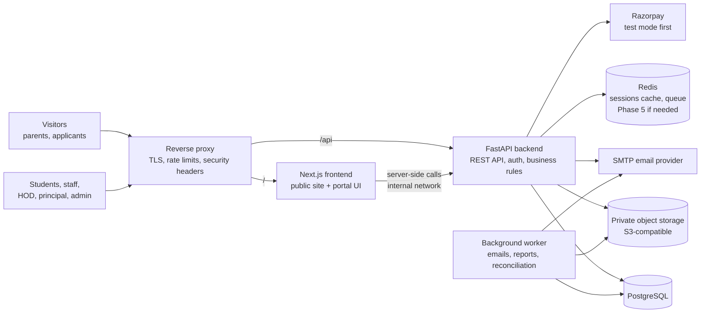

# Architecture

Phase 0 deliverable. This document is a design, not a description of running software. **Nothing described here is implemented yet.** It covers all seven phases (0 to 6) so that every phase builds on one consistent structure.

## 1. Principles

1. **One application, built progressively.** The same repository, folder layout and conventions from Phase 0 to Phase 6. No rewrites between phases.
2. **Modular monolith.** One frontend app and one backend API with clear internal modules. Microservices are deliberately rejected: the team is small, the user base is a single college, and operational simplicity matters more than independent scaling.
3. **The browser never talks to PostgreSQL.** Only the backend holds database credentials.
4. **Authorisation is enforced on the backend.** Hiding a menu item in the UI is never a security control.
5. **Free and open-source first,** with paid services only where they are genuinely needed (see PRODUCTION_COSTS.md).
6. **Secrets live in environment configuration or a secret store,** never in code or documents.
7. **Content honesty.** Verified, unverified, placeholder and demo data are always distinguishable (see CONTENT_VERIFICATION.md).

## 2. System context



The reverse proxy exposes the frontend and the API under one origin (`/` and `/api`). Same-origin cookies avoid cross-site cookie complexity and keep CORS closed.

## 3. Repository layout

```text
skec-digital-campus/
  README.md
  .env.example
  .gitignore
  docs/                      architecture, design, plans, progress (this folder)
  frontend/                  Next.js app (scaffolded in Phase 1)
    public/images/<category>/   served images (see ASSET_MANIFEST.md)
    src/content/image-manifest.json
  backend/                   FastAPI app (scaffolded in Phase 2)
  deployment/                Dockerfiles, compose files, proxy config (from Phase 2 onward)
  assets/                    incoming originals and placeholder source art
  scripts/                   generators and validation scripts
```

Planned internals (created in the phase shown, not now):

```text
frontend/src/
  app/(public)/...           public marketing and information pages          Phase 1
  app/(portal)/...           authenticated portals, route groups by role      Phase 3+
  components/ui/             shadcn/ui components restyled to the design system
  components/site/           header, footer, SiteImage, ImagePlaceholder     Phase 1
  content/                   typed content files + image manifest             Phase 1
  lib/api/                   typed API client generated from OpenAPI          Phase 3
backend/app/
  main.py, core/             settings, security, logging, dependencies        Phase 2
  db/                        SQLAlchemy base, session, Alembic migrations     Phase 2
  modules/<domain>/          router.py, schemas.py, service.py, repository.py, models.py
  workers/                   background jobs                                  Phase 5
backend/tests/               pytest unit and integration tests
```

## 4. Frontend architecture

| Aspect | Decision |
|---|---|
| Framework | Next.js (App Router), React, TypeScript in strict mode |
| Styling | Tailwind CSS with tokens from DESIGN_SYSTEM.md; shadcn/ui components owned in-repo; Lucide icons |
| Public site rendering | Static generation with revalidation for informational pages, so they are fast and cheap to host |
| Portal rendering | Server-rendered with session check; client components for interactive tables and forms |
| Content (Phases 1 to 3) | Typed TypeScript/JSON content files in `src/content/`, easy to review against CONTENT_VERIFICATION.md |
| Content (Phase 4 onward) | News, circulars, events, gallery and downloads move to the database through an admin CMS; informational pages stay in content files unless the college needs editing rights |
| Images | Referenced by ID through `SiteImage`; branded placeholders until approved (ASSET_MANIFEST.md) |
| Data access | Server components call the API over the internal network; browser calls `/api` on the same origin; typed client generated from the backend OpenAPI schema |
| Forms | React Hook Form with Zod validation; the backend is the authority and re-validates everything |
| SEO | Clean titles and descriptions, sitemap, robots, structured data for the organisation, redirects from legacy URLs (the old site uses paths like `/Aboutus`, `/Grivance`) |
| Accessibility | WCAG 2.2 AA targets, axe checks in Playwright |
| Internationalisation | English first; folder and component structure leave room for Tamil without a rewrite |

## 5. Backend architecture

| Aspect | Decision |
|---|---|
| Language and framework | Python 3.12, FastAPI, Pydantic v2 |
| ORM and migrations | SQLAlchemy 2.x (typed), Alembic migrations checked in and run in CI |
| Layering | Router (HTTP) -> Service (business rules, authorisation checks) -> Repository (queries). Routers hold no business logic. |
| Modules | `identity`, `org`, `people`, `academics`, `attendance`, `assessment`, `question_papers`, `finance`, `communications`, `placements`, `alumni`, `cms`, `grievance`, `audit`, `files` |
| API style | JSON REST under `/api/v1`, OpenAPI published, consistent error format, cursor pagination for large lists |
| Validation | Pydantic models for every request and response; no raw dict payloads |
| Background work | Introduced only when needed (emails, report generation, payment reconciliation): a worker process with a Redis-backed queue. Until then, FastAPI background tasks are sufficient. |
| Configuration | `pydantic-settings` reading environment variables; startup fails fast when required settings are missing |
| Logging | Structured JSON logs with request IDs; no personal data or secrets in logs |
| Time | UTC stored, `Asia/Kolkata` displayed |

## 6. Database

PostgreSQL (current stable major version at build time). Detailed entities in DATABASE_PLAN.md.

- UUID primary keys, `created_at`, `updated_at`, and soft-delete (`deleted_at`) where records have legal or academic value.
- Foreign keys and check constraints enforced in the database, not only in code.
- Migrations only through Alembic; no manual schema edits.
- Principle of least privilege: the app user cannot create or drop schemas; migrations run with a separate role.
- Sensitive columns (for example government identifiers if ever required) are encrypted at application level with `FIELD_ENCRYPTION_KEY`, and the plan is to avoid collecting them at all.
- Backups with restore tests (see section 12).

## 7. Authentication and authorisation

### Authentication

| Item | Decision |
|---|---|
| Password hashing | **Argon2id** (via `argon2-cffi`), parameters from environment, reviewed yearly |
| Sessions | Server-side sessions identified by a random opaque ID stored in an `HttpOnly`, `Secure`, `SameSite=Lax` cookie; session data in PostgreSQL (Redis cache later). **No JWTs in browser storage.** |
| Session lifetime | Idle timeout 30 minutes, absolute timeout 12 hours (configurable); revoke on password change; "sign out everywhere" |
| CSRF | Double-submit token plus `SameSite`, enforced for state-changing requests |
| MFA | TOTP (authenticator app) **mandatory for privileged roles**: principal, HOD, college admin, finance admin; optional for staff; recovery codes stored hashed. Students: optional at first. |
| Brute-force defence | Per-account and per-IP rate limits, progressive delays, lockout with audit entry, generic error messages |
| Account lifecycle | Invitation-based onboarding, forced password change on first login, email-verified reset with short-lived single-use tokens |
| Existing portal | No integration with, or credential reuse from, `online.skec.edu.in`. Any migration of records happens only through data the college officially exports. |

### Authorisation (RBAC with scopes)

Roles: `student`, `staff`, `hod`, `principal`, `college_admin`, `finance_admin`, `exam_cell`, `placement_officer`, `content_editor`, `system_admin`. A user can hold several roles.

Permissions are explicit strings (for example `attendance.mark`, `results.publish`, `question_paper.download`). Role-to-permission mapping lives in the database and is seeded by migration. Every permission is checked with an optional **scope**: department, batch, section, or own-record. Examples: an HOD's `attendance.view` is scoped to their department; a student's `results.view` is scoped to their own record.

Enforcement sits in backend service functions through a single `authorize(user, permission, resource)` function with unit tests for each rule. Deny by default.

### Audit logging

Append-only `audit_logs` table (who, when, action, target, before/after summary, IP, request ID). Logged events include logins, failed logins, MFA changes, role changes, result publishing, fee adjustments, question-paper access, and exports. Audit rows are never edited; deletion is restricted to a retention job with its own audit record.

## 8. Application security controls

- TLS everywhere; HSTS; strict security headers (CSP, X-Content-Type-Options, Referrer-Policy, frame protection).
- Input validation at the edge (Pydantic/Zod) and parameterised queries only (no string-built SQL).
- Output encoding by React; no `dangerouslySetInnerHTML` for user content; sanitised rich text where editors are used.
- Upload controls: type allow-list by content, size limits, random storage names, virus scanning (ClamAV) before availability.
- Dependency scanning and lockfiles; Dependabot-style alerts reviewed (done through the hosting platform when one exists; no GitHub operations are performed by this project).
- Secrets only in environment configuration; `.env` ignored by version control; no secrets in logs, docs or ZIPs.
- Rate limiting on public forms and auth endpoints; honeypot field and server-side validation on the enquiry form.
- Privacy: personal data minimisation, retention schedule, role-based visibility, and compliance review against India's Digital Personal Data Protection Act, 2023 and its Rules. Many students are minors, so parental-consent handling must be reviewed with the college and legal counsel.

## 9. File storage

- **Private object storage** (S3-compatible: MinIO in development and self-hosting; a managed S3-compatible service is a production option). Buckets: `skec-private` (no public access) and `skec-public-media` (CMS images, gallery).
- Files are never served directly from the application disk.
- **Question papers:** stored encrypted at rest, accessible only through the backend, which checks permission and scope, writes an audit entry, and issues a short-lived signed URL (default 120 seconds) or streams the file. Download watermarking with user and timestamp is a Phase 5 hardening item.
- Public media goes through an image pipeline (resize, WebP/AVIF) before publication.

## 10. Integrations

| Integration | Approach | Phase |
|---|---|---|
| Payments | **Razorpay** behind a `PaymentGateway` interface so another provider can be swapped in. Order creation on the backend; amount computed server-side from the fee record; signature verification of callbacks; **webhook** verification with a secret; idempotency keys; payment events stored raw; reconciliation job. **Test mode first.** Live mode requires authorised college credentials, written approval and a go-live checklist. Card data never touches our servers. | 5 |
| Email | SMTP provider behind an `EmailSender` interface; templated messages; bounce handling noted | 5 |
| SMS / WhatsApp | Optional. India requires telecom DLT registration for transactional SMS, so this is treated as a later, college-led decision | After 5, if requested |
| Existing college ERP | **Not assumed.** No access to its database or records is planned. If the college later provides official exports, an import tool is built, validated and audited. | Optional |
| Analytics | Privacy-respecting analytics (self-hosted or cookie-less) decided at Phase 5; no advertising trackers | 5 |

## 11. Infrastructure (Docker)

Development and production use the same container images.

| Service | Purpose | Introduced |
|---|---|---|
| `frontend` | Next.js | Phase 1 |
| `backend` | FastAPI (Uvicorn/Gunicorn) | Phase 2 |
| `postgres` | PostgreSQL with named volume | Phase 2 |
| `proxy` | Caddy or Nginx, TLS, `/` and `/api` routing | Phase 2 |
| `minio` | Private object storage (dev and self-host) | Phase 4 |
| `redis` | Cache and queue | Phase 5, only if needed |
| `worker` | Background jobs | Phase 5 |
| `clamav` | Upload scanning | Phase 5 |

Docker Compose files (`deployment/compose.dev.yml`, `compose.prod.yml`) pair with `.env` files created from `.env.example`.

**Claude Free limitation (important):** the chat sandbox cannot be assumed to run Docker. Container definitions can be written and statically checked here, but **cannot be proven to build or start inside this chat**. Every phase report will say exactly what was executed (for example unit tests, linting, type checks, database tests against a locally installed PostgreSQL where the sandbox allows it) and what was not.

## 12. Environments and deployment

| Environment | Purpose | Data |
|---|---|---|
| Development | Local build and tests | Demo data only, clearly marked |
| Staging | Pre-release review by the college | Anonymised or demo data |
| Production | Live | Real data, restricted access |

Deployment target options (decision deferred to Phase 5 with the college): a single virtual server running Docker Compose, or a managed container platform; managed PostgreSQL versus self-managed. Region should be in India where practical, for latency and data-residency comfort. CI runs tests and builds images; releases are tagged; database migrations run as a distinct, reviewed step; rollbacks are rehearsed. Backups: nightly database dumps plus point-in-time recovery if available, encrypted, stored off the primary host, with a **restore test before go-live**.

## 13. Observability

Health endpoints (`/healthz`, `/readyz`), structured logs, error tracking (Sentry-compatible, optional), uptime monitoring, and dashboards for request rate, error rate, slow queries and failed logins. Alerts go to a named college IT contact.

## 14. Testing strategy

| Layer | Tool | Scope |
|---|---|---|
| Backend unit | Pytest | Services, permission rules, fee calculations, grade logic |
| API integration | Pytest with HTTPX test client | Every endpoint including authorisation failures |
| Database integration | Pytest against real PostgreSQL | Migrations up/down, constraints, queries |
| Frontend component | Vitest or Jest with Testing Library | Components and form behaviour |
| End-to-end | Playwright | Public journeys and portal logins per role |
| Accessibility | axe via Playwright | Key pages |
| Security | Static analysis (Bandit, ESLint security rules), dependency audit, targeted authorisation tests | CI |
| Load | k6 or Locust at Phase 6 | Admissions season peaks |

A feature is "complete" only when implemented **and** its tests exist **and** were run, with output reported.

## 15. Phase to architecture map

| Phase | Architecture elements delivered |
|---|---|
| 0 | Foundation documents, folder layout, manifests, validation script |
| 1 | Frontend app, design tokens, `SiteImage`, public pages, enquiry form UI (no real submission storage yet) |
| 2 | Backend skeleton, PostgreSQL, SQLAlchemy models for core entities, Alembic, health checks, enquiry persistence, proxy and compose files |
| 3 | Authentication, sessions, MFA, RBAC, audit logs, portal shells for each role |
| 4 | ERP modules: academics, attendance, assignments, examinations, results, fees, circulars, placements, question papers, private storage |
| 5 | Razorpay test-mode adapter, email notifications, storage hardening, security hardening, background worker |
| 6 | Full test run, performance work, deployment preparation, documentation, final archive |

## 16. Architecture decisions (summary)

| # | Decision | Alternatives considered | Why |
|---|---|---|---|
| D-01 | Modular monolith | Microservices | Small team, one institution, lower ops burden |
| D-02 | Server-side sessions in cookies | JWT in local storage | Revocable, not readable by scripts, simpler for portals |
| D-03 | Same-origin `/api` through proxy | Separate API domain with CORS | Fewer cookie and CORS pitfalls |
| D-04 | Argon2id | bcrypt | Memory-hard, current guidance |
| D-05 | Static content files for public pages first | Headless CMS immediately | Fastest path to a reviewed public site; CMS added when the college needs self-editing |
| D-06 | Razorpay behind an interface | Direct SDK calls everywhere | Keeps provider swappable; test mode first |
| D-07 | Redis and worker deferred | Add from the start | Avoid moving parts until a feature needs them |
| D-08 | Images by ID with manifest | Hard-coded paths | Replacing photos needs no page edits |

Any deviation from this document must be recorded in PROJECT_PROGRESS.md with a technical reason.
