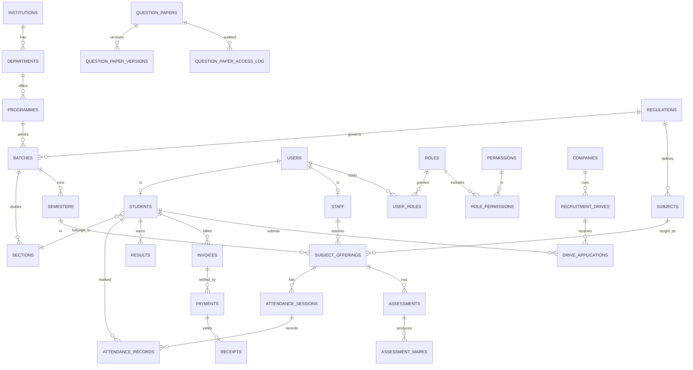

# Database Plan

Phase 0 deliverable. This is a **plan**. No schema, model or migration exists yet. Implementation starts in Phase 2 (core entities) and grows through Phase 4. The college's existing ERP database is **not** assumed to be available; every table here is designed from the requirements in the project brief.

## 1. Conventions

| Topic | Rule |
|---|---|
| Engine | PostgreSQL, accessed only by the backend |
| Naming | `snake_case`, plural table names, `<entity>_id` foreign keys |
| Primary keys | UUID (generated by the application) |
| Timestamps | `created_at`, `updated_at` as `timestamptz` (UTC) on every table |
| Soft delete | `deleted_at` on records of academic, financial or legal value; hard delete only for transient data |
| Integrity | Foreign keys, `NOT NULL`, unique constraints and `CHECK` constraints in the database |
| Money | `numeric(12,2)` in INR, with an explicit `currency` column defaulting to `INR`; never floats |
| Enums | PostgreSQL enums or lookup tables, chosen per stability of the value set |
| Migrations | Alembic only, reviewed, reversible where possible |
| PII | Columns classified (public, internal, personal, sensitive); sensitive data minimised and encrypted at application level |
| Audit | Every create, update and delete on sensitive entities writes to `audit_logs` |
| Tenancy | Single institution; an `institutions` row represents SKEC. Whether Sri Krishna Institute of Technology shares the platform is an open question (C-05 in CONTENT_VERIFICATION.md). |

## 2. Entity groups

### 2.1 Identity and access (Phase 2 models, Phase 3 behaviour)

| Table | Key columns and notes |
|---|---|
| `users` | id, email (unique, citext), password_hash (Argon2id), status, last_login_at, must_change_password, mfa_enabled |
| `roles` | id, code (unique), name |
| `permissions` | id, code (unique, for example `attendance.mark`), description |
| `role_permissions` | role_id, permission_id |
| `user_roles` | user_id, role_id, scope_type (`global`, `department`, `batch`, `section`, `self`), scope_id, granted_by, granted_at |
| `sessions` | id (opaque hash), user_id, created_at, last_seen_at, expires_at, ip, user_agent, revoked_at |
| `mfa_factors` | id, user_id, type (`totp`), secret (encrypted), confirmed_at |
| `mfa_recovery_codes` | id, user_id, code_hash, used_at |
| `password_reset_tokens` | id, user_id, token_hash, expires_at, used_at |
| `login_attempts` | id, identifier, ip, success, attempted_at |
| `audit_logs` | id, occurred_at, actor_user_id, action, target_type, target_id, summary (jsonb), ip, request_id; append-only |

### 2.2 Organisation and academic structure (Phase 2/4)

| Table | Notes |
|---|---|
| `institutions` | name, code (counselling code 1427 once confirmed), address |
| `departments` | institution_id, code, name, hod_staff_id |
| `programmes` | department_id, level (`UG`, `PG`), degree (`B.E.`, `B.Tech.`, `M.E.`, `M.B.A.`), name, duration_years, approved_intake, status |
| `regulations` | code (for example `R2025`), effective_from |
| `academic_years` | label (`2026-2027`), starts_on, ends_on, is_current |
| `batches` | programme_id, regulation_id, admission_year, graduation_year |
| `semesters` | batch_id, number, academic_year_id |
| `sections` | batch_id, name |
| `subjects` | regulation_id, programme_id, code, title, credits, type (theory/lab/project) |
| `subject_offerings` | subject_id, semester_id, section_id, staff_id |

### 2.3 People (Phase 4)

| Table | Notes |
|---|---|
| `students` | user_id, register_number (unique), admission_number, programme_id, batch_id, section_id, date_of_admission, status; personal data kept in `student_profiles` |
| `student_profiles` | student_id, full_name, date_of_birth, gender, contact, address, photo_file_id; guardian details minimised |
| `guardians` | student_id, name, relationship, phone, email, consent_recorded_at (relevant for minors) |
| `admissions` | applicant details, quota, status workflow, linked `student_id` on enrolment |
| `staff` | user_id, employee_id (unique), department_id, designation, date_of_joining, status |
| `staff_profiles` | staff_id, qualifications, contact, photo_file_id |
| `staff_assignments` | staff_id, department_id, role (HOD, class advisor, coordinator), from_date, to_date |

### 2.4 Academics (Phase 4)

| Table | Notes |
|---|---|
| `timetable_slots` | subject_offering_id, day_of_week, period, room, effective_from, effective_to |
| `attendance_sessions` | subject_offering_id, slot_id, session_date, marked_by, locked_at |
| `attendance_records` | attendance_session_id, student_id, status (`present`, `absent`, `od`, `leave`), unique(session, student) |
| `assignments` | subject_offering_id, title, instructions, due_at, max_marks, created_by |
| `assignment_submissions` | assignment_id, student_id, file_id, submitted_at, marks, feedback |
| `assessments` | subject_offering_id, type (`internal`, `model`, `semester`), name, max_marks, weightage, scheduled_on |
| `assessment_marks` | assessment_id, student_id, marks, entered_by, status (`draft`, `submitted`, `published`) |
| `exam_sessions` | semester_id, name, starts_on, ends_on |
| `exam_timetable_entries` | exam_session_id, subject_id, exam_date, session (FN/AN) |
| `grade_scales` | regulation_id, grade, min_marks, points |
| `results` | student_id, exam_session_id, subject_id, marks, grade, status, published_at |
| `result_summaries` | student_id, semester_id, sgpa, cgpa |

### 2.5 Question paper management (Phase 4, hardened Phase 5)

| Table | Notes |
|---|---|
| `question_papers` | subject_id, exam_session_id, title, status (`draft`, `locked`, `released`) |
| `question_paper_versions` | question_paper_id, file_id, version, uploaded_by, checksum |
| `question_paper_access_grants` | question_paper_id, user_id or role, scope, valid_from, valid_until |
| `question_paper_access_log` | question_paper_id, user_id, action (`view`, `download`), at, ip |

Files sit in private object storage; the database holds metadata only.

### 2.6 Finance (Phase 4, payments Phase 5)

| Table | Notes |
|---|---|
| `fee_structures` | programme_id, academic_year_id, name, quota |
| `fee_components` | fee_structure_id, name, amount, due_date, is_refundable |
| `student_fee_assignments` | student_id, fee_structure_id, concession_amount, concession_reason, approved_by |
| `invoices` | student_id, number (unique), total, status, issued_at, due_at |
| `invoice_lines` | invoice_id, fee_component_id, amount |
| `payments` | invoice_id, method, amount, status, gateway (`razorpay`, `offline`), gateway_order_id, gateway_payment_id, idempotency_key (unique), paid_at |
| `payment_gateway_events` | raw webhook payload (jsonb), signature_valid, received_at, processed_at |
| `receipts` | payment_id, number (unique, gap-free sequence), file_id, issued_at |
| `refunds` | payment_id, amount, reason, status, approved_by |
| `reconciliation_batches` | period, gateway_total, ledger_total, difference, status |

Card or bank-account data is never stored.

### 2.7 Communication (Phase 4/5)

| Table | Notes |
|---|---|
| `circulars` | title, body, audience (jsonb), published_by, approved_by, published_at, attachment_file_ids |
| `announcements` | title, body, audience, starts_at, ends_at |
| `notifications` | user_id, type, payload, read_at |
| `notification_deliveries` | notification_id, channel (`in_app`, `email`), status, provider_message_id, error |
| `email_templates` | code, subject, body, version |

### 2.8 Placement and alumni (Phase 4)

| Table | Notes |
|---|---|
| `companies` | name, website, contact |
| `recruitment_drives` | company_id, title, date, eligibility, status |
| `drive_applications` | drive_id, student_id, status |
| `internships` | company_id, title, duration, stipend_note, applications |
| `placement_records` | student_id, company_id, role, offer_date, package_note; published statistics only from reviewed records |
| `alumni` | name, programme_id, graduation_year, current_employer, contact_consent |
| `alumni_events` | title, date, description |

### 2.9 Administration and staff operations (Phase 4)

| Table | Notes |
|---|---|
| `leave_types` | code, name, annual_quota |
| `leave_requests` | staff_id, leave_type_id, from_date, to_date, reason, status, approver_id |
| `staff_attendance` | staff_id, date, status, source |
| `file_objects` | id, storage_key, original_name, content_type, size, sha256, scan_status, uploaded_by, bucket, visibility |
| `report_exports` | requested_by, report_type, parameters, file_id, created_at (also written to the audit log) |

### 2.10 Website and public interaction (Phase 2/4)

| Table | Notes |
|---|---|
| `enquiries` | name, contact, programme_interest, message, source, status, created_at; persistence starts in Phase 2 |
| `grievances` | reference number, category, submitter details (optional anonymity), description, status, assigned_to, resolution |
| `grievance_events` | grievance_id, actor, action, note, at |
| `committees` | name, type, constitution_date, members (see below) |
| `committee_members` | committee_id, name, designation, contact |
| `news_posts` | title, slug, body, published_at, status, cover_image_id |
| `events` | title, slug, starts_at, ends_at, venue, description, cover_image_id |
| `gallery_albums` / `gallery_items` | album, item, alt text, credit, consent_recorded |
| `media_assets` | file_object_id, alt_text, credit, approved_by |
| `download_documents` | title, category, file_id, published_at, valid_until |

## 3. Core relationships

## 4. Key constraints and rules

- `attendance_records`: unique on (`attendance_session_id`, `student_id`); a session becomes read-only after `locked_at`, with later changes going through a reasoned amendment that is audited.
- `assessment_marks`: marks cannot exceed `assessments.max_marks` (check constraint); publishing moves rows from `submitted` to `published` and is audited.
- `results`: unique on (`student_id`, `exam_session_id`, `subject_id`); published rows are immutable except through a corrective revision record.
- `invoices.number` and `receipts.number` come from gap-free database sequences; receipts are never deleted.
- `payments.idempotency_key` is unique so a retried gateway callback cannot double-credit an invoice.
- `user_roles` scope: a scoped role requires `scope_id`; a `global` role forbids it (check constraint).
- Only one `is_current` academic year (partial unique index).
- Student `register_number` and staff `employee_id` are unique and immutable once issued.

## 5. Indexing and performance notes

Indexes on every foreign key; composite indexes for the hot queries (attendance by `student_id` and date range, results by `student_id` and `exam_session_id`, invoices by `student_id` and status); partial indexes for active rows; `pg_trgm` for name search in admin screens. Large append-only tables (`audit_logs`, `attendance_records`, `payment_gateway_events`) are candidates for time-based partitioning, evaluated in Phase 6 with real volumes.

## 6. Data protection and retention

| Data | Classification | Handling |
|---|---|---|
| Credentials, MFA secrets | Sensitive | Hashed (Argon2id) or encrypted; never logged |
| Student and guardian personal data | Personal | Role-scoped access, audited reads of full profiles, minimised fields |
| Marks and results | Personal, high integrity | Immutable once published; revisions tracked |
| Payments | Personal, financial | Gateway tokens only; no card data |
| Question papers | Confidential | Private storage, signed short-lived access, audit |
| Enquiries and grievances | Personal | Retention period agreed with the college; anonymisation after expiry |

Retention periods, consent records for minors and data-subject request handling must be agreed with the college and reviewed against the Digital Personal Data Protection Act, 2023 and its Rules. These are open items, not decisions.

## 7. Seed data and demo data

Seed data (roles, permissions, grade scales) is created by migration. Demo students, staff and results are generated only in development and staging, flagged `is_demo = true`, using obviously fictional names, and are excluded from production by an automated check.

## 8. Open questions for the college

1. Is the platform for SKEC only, or also for Sri Krishna Institute of Technology?
2. Approved intake and current programme list (C-01).
3. Grading scheme and result publication rules per regulation.
4. Fee heads, concessions, quota rules, and the receipt numbering format.
5. Required attendance thresholds and the on-duty process.
6. Retention periods and consent process for minors.
7. Whether historical records from the existing system will be provided as official exports.
